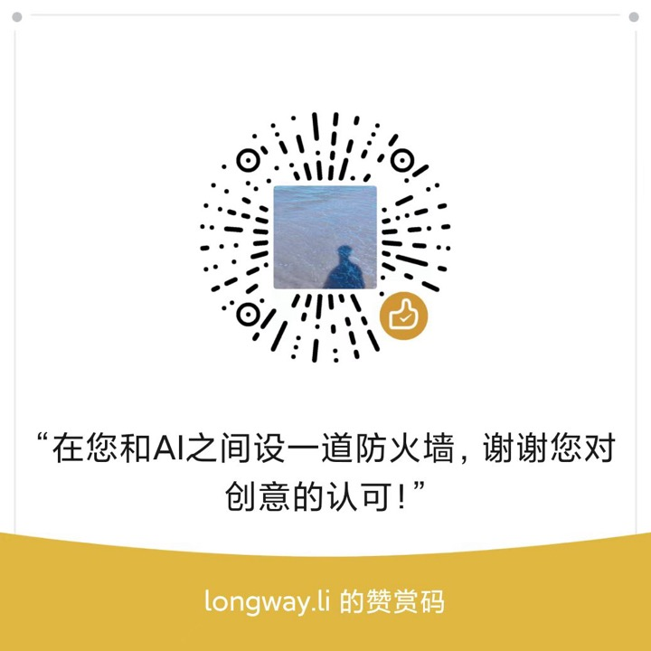

# Undecided

> A desk for the things you have not decided.

**中文: [README.md](./README.md)** ｜ **Live: <https://yutianbottle.github.io/undecided/>**

A decision ledger that never goes online. You write down what is still undecided, make the call, seal it, and open it again when it is due — the prediction you wrote sits next to the result you got.

No account, no server, no AI advice. The data stays on your own machine.

---

## You have probably had these

Thursday night. A client messages you a brief and wants a price by tomorrow. You scroll back through the chat three times, find what you quoted last time, and adjust it by 20% on feel.

One in the morning. You are still thinking about the product you have been building for eleven months: twelve paying users. Keep going or stop? You know you should set a deadline. You do not know what to set it to.

A client introduced by a friend. You hesitated on the quote — the right number was 32,000, you said 26,000. Not because their budget was low. Because you were afraid they would think you were expensive.

None of these were hard to figure out. They were **never decided**.

And never decided wears you down more than decided wrong.

---

## What it does

Three things. There is no fourth.

1. **Makes what is hanging visible.** Every item has a deadline, a state, and "hanging for N days".
2. **Puts what you should know in front of you.** Not advice — where people usually go wrong in this kind of decision, what methods exist, whether there is data.
3. **Brings you back to your prediction.** Whatever you wrote at the call gets taken out on the day and set beside the result.

---

## What it does not do

- **It does not advise you.** No recommended option, no scoring, no ranking, no "decision-making score".
- **It does not go online.** No model, no uploads. Once the page is open, it keeps working with the network off.
- **It does not keep your data.** There is no backend. Change browser, clear the cache, and it is gone — so export regularly.

This is not a limitation. It is deliberate.

**Something that chooses for you will, in time, leave you unable to choose.**

---

## How this differs from asking an AI

Ask an AI "what should I quote for this" and it will say: assess the client's budget, benchmark against market rates, leave room to negotiate.

All true. The problem is what it does not know: this client paid you 45 days late last time, and quoting low made them trust you less, not more.

Undecided does the reverse — **it puts the three things an AI would say in front of you, then asks: which one does not apply to you?**

The sentence you write about *why* is the real variable in the decision.

**An AI gives you a general answer. You supply the situation. Only the second one can make a decision.**

---

## The eight gates

Not every decision deserves a slow pass. Some should be made now; some deserve thought.

```
Slower to know ↑
               │          · Partner        · Keep or kill
               │
               │                    · Hire
               │      · Pricing   · Channel  · Raise prices
 Know quickly  │  · Take client        · Quote
               └──────────────────────────────────────────→
                 Can be undone              Cannot be undone
```

- **Bottom left** (reversible, days to know): do it now. No meeting.
- **Top right** (cannot be undone, months to know): worth ten minutes of a full pass.

Eight kinds: quoting, taking a client, pricing, keep or kill, hiring, partnership, channel, raising prices.

---

## Before you start: check your state

"New decision" does not drop you straight into the flow. First it asks four things:

- **Tired** — short on sleep, or running on empty
- **Hungry** — you have not eaten properly today
- **Angry** — a conflict just happened and has not settled
- **Rushed** — you want it settled today, badly

Tick any one and it will not let you continue. All it says is: **it will still be here tomorrow.**

This is not a moral reminder. In that state everything tilts one way — what deserves caution gets rushed, what deserves letting go gets held onto. It is not that your judgement is poor; it is that what you can see right now is off.

It is not recorded, not scored, and not one of the seven steps. It just stands at the door.

---

## How one decision goes

1. **Options** — one of them must be "do nothing / decline / keep as is", and you mark it yourself.
2. **Facts** — three at most, 60 characters each. **After the third fact, you are usually building a case.**
3. **Third-person question** — if a friend sat here, what would you tell them?
4. **The light** — the usual errors for this kind of decision, one move you can use now, whether any data exists.
5. **The call** — pick one, write a prediction with a number in it, and a probability. **Eight seconds of stillness before you commit.** You can also enter one optional figure: an amount in money gates, days in people/product gates.
6. **Seal** — a seal code is generated and the record becomes read-only.
7. **Review** — on the due date the prediction and the result sit side by side, and you mark whether it matched what you expected. If you noted a figure at the call, you can record the actual one here.

If you write "this time is different", you have to name an observable signal, or you cannot proceed.

---

## Why it is dark, and why there is only one light

These decisions happen at night — a client messages you just before bed, you are still awake at 1am, you run through the message you did not dare answer. A white screen at those hours is asking you to work overtime, so it is a dark desk with warm paper on it. And there is one light on that desk, because the product offers no judgement, only visibility: it lights up one caution, one move, one answer to "is there data". A desk lamp, not a lit room.

---

## It gets more like you as you use it

- **Before the call**, if you have decided in the same gate before, your previous choice, prediction, result and review are placed in front of you before you sign.
- **The ledger** counts how many times you have decided in each gate. An untouched gate shows one line; the knowledge unfolds only after you have decided there — reading it before you have been burned in that situation is just words.
- **The lighting cards are random per case.** Two quotes in the same gate do not show the same bias card; the seed is the case id, so reopening one case shows the same card — it must not jump while you read it.
- **Your own bias.** At the call you can optionally enter one figure; at review you enter the actual one. After three pairs both that gate's page and the Me page state the pattern in your own numbers. The unit follows the gate — money gates take an amount, people/product gates take days:

  > Quoting: you expected ¥44,250 on average, it closed at ¥37,500. You tend to price high by 15% — next time multiply by 0.85.
  > Hiring: you expected 31.7 days, it took 44.3. Your estimates run fast by 40% — multiply by 1.4.

  This is the only number on the site computed from your own data, and it needs no ledger backfill to start.
- **The Me page** holds your prediction distribution, your reviewed results, and every case, searchable by keyword and filterable by gate and status. The "Your baseline" section at the top puts every gate's logged figures side by side; gates short of three pairs show "2 / 3" rather than a verdict.
- **Open early**: if the outcome is already clear, you can review before the due date. Both the scheduled date and the actual opening time are kept.

None of this is shown to anyone. It is only for you.

---

## Your data is in your hands

- Stored in the browser's localStorage. **It never touches a server.**
- **Me → Data** exports two formats:
  - **Markdown** — a readable letter, for yourself or someone else
  - **JSON** — a backup you can import later
- Importing JSON validates and previews first, then you choose **merge** or **replace**.
- The top bar shows "Local only · saved". On a phone there is no persistent badge, but any saving problem is reported at the top of the page.
- **No data is retained, backed up or recoverable by this project.** Change devices or clear the cache and it is gone. Export on your own schedule.

That is both the advantage and the risk: you take all the control, and all the responsibility.

---

## Running it

Node.js 18 or later.

```bash
npm install
npm run dev
```

Open `http://localhost:5188`.

**Always use the same address.** Data is stored per origin (protocol + host + port): a different port (5189, say) is a different, empty ledger — the old data still exists, this address just cannot see it. If the port is taken the program fails loudly instead of quietly moving to another one, precisely to prevent this.

Closing the terminal or rebooting will not lose your data. Only these will: a different address, a different browser, clearing the cache.

### Language

Switch between **中文 / English** in the top bar. It takes effect immediately and does not touch the cases you have already written.

- Interface text, the eight gates, the 45 decision cards and the evidence notes are all bilingual
- Book titles keep the language they were published in (Chinese editions are not translated), so they remain findable by their original name
- The choice is stored locally; next time you get the same one

### Not seeing a new version after an update?

If you installed it as an app and then changed the code, the browser keeps serving the old build. Once the new one is installed, a bar appears at the bottom of the page: "A new version is ready — refresh." Click refresh; your records are untouched.

Building static files:

```bash
npm run build      # output in dist/
npm run preview    # local preview
```

`dist/` can be deployed to the root path of any static host.

---

## Install it as an app (recommended if you use it long-term)

`npm run dev` means opening a terminal every time. If you plan to keep using this, deploy it once and then just click an icon.

**Option 1: GitHub Pages (already configured)**

A push to `main` builds and deploys automatically; the workflow is in `.github/workflows/deploy.yml`.

1. In your repository, go to Settings → Pages
2. Set Source to **GitHub Actions**
3. Push a commit, or run "Deploy to GitHub Pages" manually from the Actions tab
4. You get `https://<your-username>.github.io/undecided/`

**Option 2: Vercel / Cloudflare Pages**

1. Push the project to a GitHub repository (public or private)
2. Open Vercel or Cloudflare Pages, sign in with GitHub, pick the repo and deploy — both recognise a Vite project and need no configuration
3. You get a fixed URL, e.g. `weijue.vercel.app`

**Then install it:**

| Device | What to do |
|---|---|
| Chrome / Edge on desktop | An install icon appears at the right of the address bar — click it |
| Safari on Mac | File → Add to Dock |
| iPhone | Open in Safari → Share → Add to Home Screen |
| Android | Chrome menu → Add to Home Screen |

It then runs full-screen from its own icon, like a native app. **It also opens offline** — the page is cached locally.

**The data is still in your own browser.**

Deploying it to the web does not upload your ledger: the server holds static pages only, no database. Anyone opening that URL sees an empty ledger; your records exist only in the browser on your device.

The cost is just as clear: change computer, change browser, clear the cache, and it is gone. **Export a JSON once a month** and keep it somewhere you can find — that is the only reliable backup.

---

## About the author

**Longway Li** — a studio of one, building tools on the side.

Homepage: <https://longway-li.pages.dev>

---

## Licence and sources

- Code and original text: **PolyForm Noncommercial 1.0.0**, see [LICENSE](./LICENSE). Use it, change it, share it non-commercially; **no commercial use, including of modified versions**. Commercial licensing requires a separate agreement. [Commits published before 2026-11-02 were MIT; those grants cannot be revoked.]
- The concepts and methods in the decision cards are **paraphrases and citations** of published work, with no verbatim excerpts; copyright remains with the authors and publishers. The full list is in the app under "About → Copyright and sources"; the card index is in [docs/02-决策照明卡总表.md](./docs/02-决策照明卡总表.md).
- **No legal, tax, psychological, investment or medical advice.** For partnership, equity or contract decisions, consult a practising lawyer.
- **No promise of better decisions.** It helps you see clearly, write it down, and come back to it.

---

## One line

This desk does not tell you what to choose.

It only guarantees that you thought about it, wrote it down, and will come back to settle the account.

---

## Support

This project is free, has no ads, and uploads nothing. Take the code, change it for yourself — but not for commercial use.

If it helped you settle something that had been hanging for a while, you can buy me a coffee.



