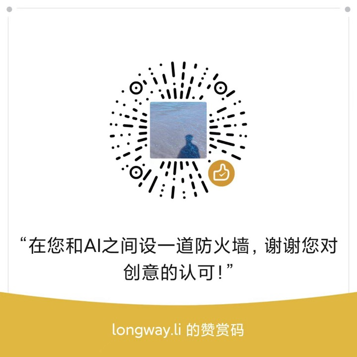

# 未决

> 一张桌子，放你还没定的事。

一个网页工具。把还没定的事摆到桌上，写清期限、选项、处境，然后落槌、封存；到期那天它回来找你，把你当时的预测和结果并排放着。

不联网，不注册，不给你建议。数据只在你自己的浏览器里。

**English: [README.en.md](./README.en.md)** ｜ **在线使用：<https://yutianbottle.github.io/undecided/>**

---

## 你可能遇到过这些

周四 21:40，客户微信发来需求，说明天给个价。你翻了三遍聊天记录，看上次报了多少钱，然后凭感觉加减了 20%。第二天报出去，没记下任何东西。

凌晨 1 点，你还在想那个做了十一个月的产品：十二个付费用户，要不要继续。你知道该设个期限，但你不知道该设成什么，于是又过了一周。

有件事你挂了 47 天了。你每天想起它一次，然后去做别的。

这些决定没有一个是"想不出来"。它们是**一直没定**。

而一直没定，比定错了更耗人。

---

## 它做什么

三件事，没有第四件：

1. **让悬着的东西显形。** 每件事有期限、有状态、有"已悬 N 天"。
2. **把该知道的东西递到眼前。** 不是建议，是这一类决定别人通常栽在哪、有什么方法能用、有没有数据。
3. **让预测到期可回看。** 你落槌时写下的预测，到日子会被拿出来，和结果并排放着。

---

## 它不做什么

- **不给你建议。** 不推荐选项，不打分，不排名，不算"决策力"。
- **不联网。** 不接任何模型，不上传任何内容。页面打开后断网也能继续用。
- **不留你的数据。** 没有后端。换浏览器、清缓存，数据就没了——所以请自己定期导出。

这不是能力不够，是故意的。

**一个会替你选的东西，用久了你就不会选了。**

---

## 和去问 AI 有什么不同

你问 AI「这单该报多少」，它会说：先评估客户预算、参考市场价、预留议价空间。

这些话都对。问题是它不知道：这个客户上次拖了你 45 天款，你上次报低价之后他反而更不信任你。

未决的做法反过来——**先把 AI 会说的三句话摆在你面前，然后问你：哪一条对你不适用？**

你写下的那句"为什么不适用"，才是这个决定真正的变量。

**AI 提供通用答案，你提供处境；只有后者能拿来做决定。**

---

## 开始之前：先看状态

点「新的决定」不会直接进流程，先问你四个问题：

- **困** —— 没睡够，或者已经撑了很久
- **饿** —— 今天还没好好吃一顿
- **气** —— 刚和人起过冲突，还没下来
- **急** —— 心里很急，想今天就把事定下来

勾中任何一项，就不让往下走，只给一句话：**这件事明天还在。**

不是道德提醒。人在这种状态下，看什么都偏向一边——该谨慎的会冒进，该放手的会硬撑。不是判断力不够，是此刻看到的东西本身就不准。

这一步不记录、不评分，也不在七步里。它只是挡在门口。

---

## 八个关口

不是所有决定都值得慢慢想。有些该现在做，有些该想清楚。

```
结果来得慢 ↑
            │        · 合伙          · 取舍
            │
            │              · 招人
            │    · 定价  · 渠道 · 涨价
   很快知道  │  · 接单          · 报价
            └────────────────────────────────→
              做错了能改            改不回来
```

- **左下**（能改、几天就知道）：现在做，别开会。
- **右上**（改不回来、半年才知道）：值得花十分钟走完一遍。

八类决定：报价、接单、定价、取舍、招人、合伙、渠道、涨价。

不属于这八类的事可以选「其他」，仍可走完封存和回看。照明阶段提供通用提醒与动作，不提供分类基准；可选记录预估与实际完成天数，逐案对照，不把不同事情合并计算偏差。

---

## 一个决定怎么走

1. **摆选项** —— 其中一项必须是「不做」——不接这单、不上这个产品、维持现状。由你自己标出来：因为「不做」常常写得很像「做」（比如"先观望"），系统不去猜。
2. **写事实** —— 最多三条，每条 60 字。**第三条之后，通常是在找理由。**
3. **换位自问** —— 如果是朋友坐在这儿，你会跟他说什么？
4. **看照明** —— 这类决定最常见的错、现在能用的一个动作、有没有数据。
5. **落槌** —— 选一个，写一句带数字的预测和概率。**落槌前有八秒静止。** 可顺手填一个数：钱类关口填报价，人/货类关口填天数。不填也能封存。
6. **封存** —— 生成封条，原始记录不再可改。
7. **回看** —— 到期时把预测和结果并排放着，由你自己标"和当时想的一样吗"。落槌时填过数的，这里再填一次实际值。

写了"这次不一样"，必须给出一个可观察的信号，否则过不去。

---

## 为什么是暗色的，为什么只有一束光

这些决定发生在夜里——客户临睡前来消息、你凌晨还醒着、睡前过一遍没敢回的话。白底的工具在那时候等于让你加班，所以它是深灰的桌面、暖白的纸。而桌上只有一束光，因为产品不提供判断，只提供可见度：一次照亮一条提醒、一个动作、有没有数。是照桌面，不是照屋子。

---

## 越用越像你

- **落槌前**，同一关口如果你以前做过决定，上一次的选择、预测、结果、复盘会被摆在你签字之前。
- **账本**里每一类决定都记着你做过几次；没做过的关口只有一句话，做过之后才展开知识。
- **照明卡按案卷随机**：同一类决定，不同案卷给的那张偏差卡不一样。同一件案卷反复打开给同一张——它不该在你看的时候跳。
- **你自己的偏差**：落槌时估一个数，回看时填实际值，累计三次之后，那个关口的账本页和「我」页会写下你自己的规律。单位跟关口走——钱类关口收金额，人/货类关口收天数：

  > 报价：你估平均 4.4 万，实际 3.8 万。你一贯报高 15%，下次给价先乘 0.85。
  > 招人：你估平均 31.7 天，实际 44.3 天。你的预估一贯偏快 40%，下次给天数乘 1.4。

  这是唯一一个用你自己的数据算出来的数，不需要联网，也不需要你先补录一年台账。
- **「我」页**有你的预测分布、回看结果，以及全部案卷：可以按关键词搜索，按关口和状态筛选。页顶的「你的基准线」把各关口填过的数并排放在一起，没满三次的直接显示「2 / 3 次」，不先给结论。
- **提前开封**：如果结果已经出现，可以在封存页提前回看。原计划日期和实际开封时间都会保留。

这些数据不给任何人看，只给你自己。

---

## 数据在你手里

- 存在浏览器的 localStorage 里，**不经过任何服务器**。
- 「我 → 数据管理」可以导出两种格式：
  - **Markdown** —— 一封能读的信，给自己或给别人看
  - **JSON** —— 备份，将来可以再导入
- 导入 JSON 会先校验、预览，再由你选择**合并**还是**替换**。
- 保存出问题会在页面顶部明确提示，不会静默吞掉。
- **不做任何数据留存、备份或恢复。** 换设备、清缓存，数据就没了。请自己定期导出。

这是它的优点，也是它的风险：你拿走了全部控制权，也拿走了全部责任。

---

## 怎么运行

需要 Node.js 18 以上。

```bash
npm install
npm run dev
```

浏览器打开 `http://localhost:5188`。

**请始终用同一个地址打开。** 数据是按「协议 + 域名 + 端口」存在浏览器里的：换个端口（比如 5189）就等于换了一个空账本——旧数据还在，只是这个地址看不到它。如果端口被占用，程序会直接报错而不是偷偷换一个，就是为了防止这件事。

关掉终端、重启电脑都不会丢数据，丢数据的只有：换地址、换浏览器、清缓存。

### 界面语言

右上角可以在**中文 / English** 之间切换，切换立刻生效，不影响已经写下的案卷。界面文案、八个关口、四十五张决策照明卡、证据来源说明都是双语；书目标题保留原出版语言，方便按原名查证。

### 更新之后看不到新版本？

如果装了 PWA 又改了代码，浏览器会先用旧版本；新版本装好之后，页面底部会出现一条「有新版本，刷新后生效」的提示，点「刷新」即可。账本数据不受影响。

打包成静态文件：

```bash
npm run build      # 产物在 dist/
npm run preview    # 本地预览
```

`dist/` 可以部署到静态托管的站点根路径。

---

## 装成 App（推荐长期使用）

用 `npm run dev` 意味着每次都要开终端。如果打算长期用，把它部署一次，之后点图标就能打开，不用碰命令。

**方式一：GitHub Pages（本仓库已配好）**

推送到 `main` 就会自动构建并部署，配置文件在 `.github/workflows/deploy.yml`。

1. 在你的仓库里打开 Settings → Pages
2. Source 选 **GitHub Actions**
3. 推一次 commit，或在 Actions 里手动运行「Deploy to GitHub Pages」
4. 得到 `https://<你的用户名>.github.io/undecided/`

**方式二：Vercel / Cloudflare Pages**

1. 把项目推到一个 GitHub 仓库（公开私有都行）
2. 打开 Vercel 或 Cloudflare Pages，用 GitHub 登录，选中这个仓库，直接部署——它们会自动认出这是 Vite 项目，不需要写任何配置
3. 拿到一个固定网址，比如 `weijue.vercel.app`

**然后装成 App：**

| 设备 | 操作 |
|---|---|
| 电脑 Chrome / Edge | 地址栏右侧出现「安装」图标，点一下 |
| Mac Safari | 文件 → 添加到程序坞 |
| iPhone | Safari 打开 → 分享 → 添加到主屏幕 |
| Android | Chrome 菜单 → 添加到主屏幕 |

装好之后就是一个独立图标，全屏运行，和本地 App 一样。**断网也能打开**——页面已经缓存在本地了。

**数据还是在你自己的浏览器里。** 部署到网上，不等于把账本传上去：服务器上只有静态页面，没有数据库。别人打开这个网址，看到的是一个空账本；你的记录只在你那台设备的浏览器里。

代价也一样清楚：换电脑、换浏览器、清缓存，数据就没了。**请每月导出一次 JSON**，放在你能找到的地方——这是唯一可靠的备份。

---

## 关于作者

**龙威（Longway Li）**：一个人做工作室，顺便做工具。

个人主页：<https://longway-li.pages.dev>

---

## 许可与引用

- 代码与自撰文案：**PolyForm Noncommercial 1.0.0**，见 [LICENSE](./LICENSE)。可以自己用、自己改、非商业分发；**不可用于任何商业目的，改过的版本也一样**。商业授权请另行联系。[2026-11-02 之前发布的提交是 MIT，已获得的授权不可撤回。]
- 决策卡中的概念与方法，是对公开文献的**转述与引用**，不含原文摘录，版权归原作者与出版方所有。完整条目见应用内「关于 → 版权声明与引用来源」，卡片总表见 [docs/02-决策照明卡总表.md](./docs/02-决策照明卡总表.md)。
- **不提供法律、财税、心理、投资或医疗建议。** 涉及合伙、股权、合同的决定，请咨询执业律师。
- **不承诺提高你的决策正确率。** 它只帮你看清楚、记下来、到期回看。

---

## 一句话

这张桌子不告诉你选什么。

它只保证：你想过，你写过，你会回来对账。

---

## 赞赏

这个项目不收费、不接广告、不上传任何数据。有人愿意打赏就打赏，不影响任何功能，也不会有任何提示；你可以一分钱都不给，全部功能都在。

如果它帮你把一个悬了很久的事定了下来，可以请我喝杯咖啡。


